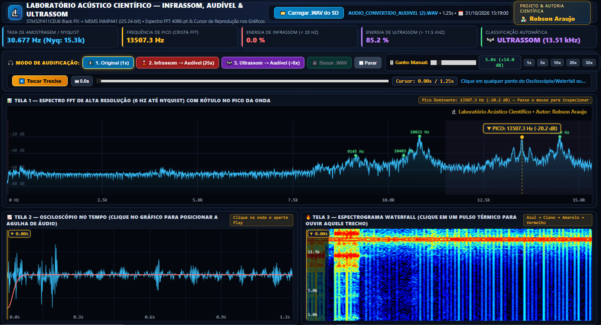
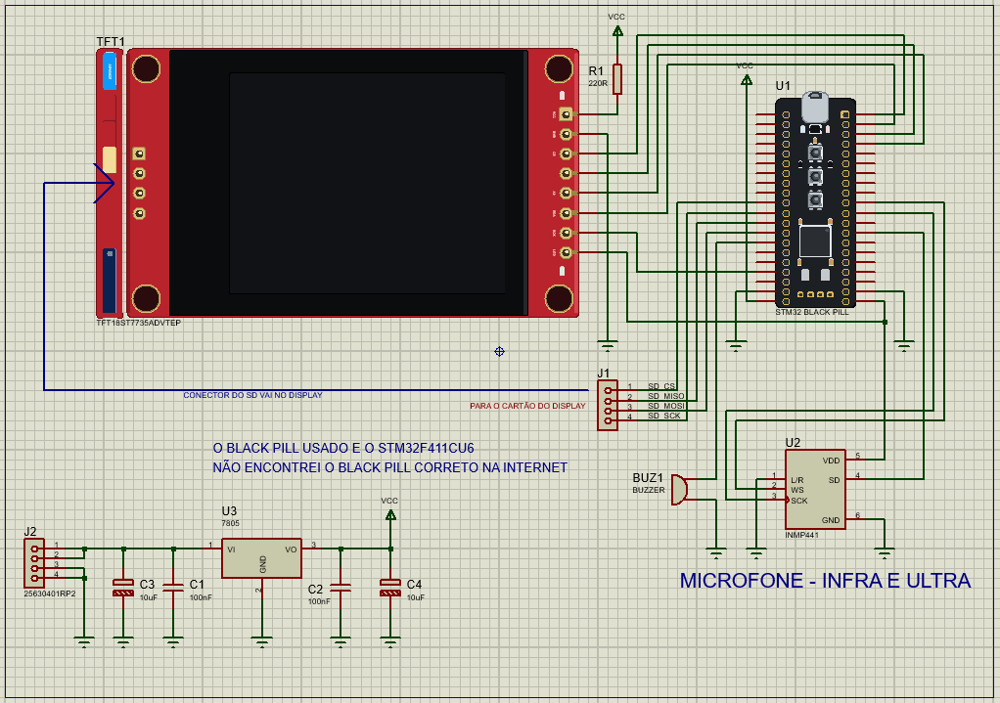

# 🔬 Estação Científica de Monitoramento, Captura e Audificação de Infrassom (< 20 Hz) e Ultrassom (até 25 kHz)

-0284c7?style=for-the-badge&logo=stmicroelectronics)
-10b981?style=for-the-badge)

> **Projeto & Autoria Científica:** **Robson Araujo**  
> **Hardware Embarcado:** STM32F411CEU6 (*Black Pill*) + Microfone Digital MEMS INMP441 + Display TFT ST7735 1.8" + Gravador MicroSD FAT32  
> **Software de Pós-Processamento (PC):** Laboratório Acústico Científico Web (`HTML5 / Web Audio API / DSP Canvas`)

---

## 📋 Visão Geral do Projeto

O ouvido humano é limitado à faixa audível compreendida aproximadamente entre **20 Hz e 20 kHz** (frequentemente reduzida para 11,5 kHz–15 kHz na idade adulta). Entretanto, fenômenos físicos, geofísicos, industriais e biológicos fundamentais ocorrem fora desse intervalo:
- **🌋 Infrassom (< 20 Hz):** Ondas acústicas de baixíssima frequência geradas por abalos sísmicos, atividade vulcânica, turbulência atmosférica, grandes motores industriais e vibrações estruturais.
- **🦇 Ultrassom (> 11,5 kHz até 25 kHz):** Emissões acústicas de alta frequência oriundas de ecolocalização biológica (morcegos, insetos), cavitação ultrassônica, vazamentos de gás pressurizado, descargas corona em redes elétricas e falhas de rolamentos mecânicos.

Este projeto apresenta um **ecossistema completo (Hardware Portátil Autônomo + Estação Científica de Pós-Processamento em PC)** capaz de:
1. **Monitorar em tempo real** toda a banda de **1 Hz até 25 kHz** usando processamento digital de sinais (DSP) com unidade de ponto flutuante (FPU) no **STM32F411CEU6**.
2. **Detectar e classificar automaticamente** eventos de **Infrassom** e **Ultrassom** (Modo Sentinela), gravando arquivos `.WAV` contínuos em **16-bit PCM (~50 kHz)** no cartão **MicroSD** com **pré-disparo (Pre-Trigger) em RAM** e **carimbo de data e hora reais (RTC)**.
3. **Audificar os sinais inaudíveis no computador**, convertendo ondas de **Infrassom (< 20 Hz)** para a faixa audível por compressão temporal (**25x mais rápido**) e ondas de **Ultrassom (> 11,5 kHz)** para a faixa audível por expansão temporal (**câmera lenta ÷6x** com filtragem passa-altas).

---

## 🖥️ Software de Pós-Processamento no PC (`analisador_cientifico.html`)

A imagem acima demonstra o **Laboratório Acústico Científico** em operação analisando uma captura real de **Ultrassom em 13.507,3 Hz (13,51 kHz)** com **85,2% da energia espectral concentrada na banda ultrassônica**.

### Destaques da Interface Científica (All-in-One Cockpit):
- **📊 Tela 1 — Espectro FFT de Alta Resolução (4096 pontos, Método de Welch + Peak-Hold):**
  - Exibe toda a faixa de `0 Hz` até a frequência de Nyquist (`~25 kHz`).
  - **Detecção Inteligente por Prominência Espectral (SNR Local):** Identifica automaticamente a frequência fundamental mesmo em sinais ultrassônicos de baixa amplitude, fixando uma etiqueta luminosa diretamente sobre a crista da onda (**`▼ PICO: 13507.3 Hz (-20.2 dB)`**) e destacando harmônicos secundários em verde (`9145 Hz`, `10403 Hz`, `10822 Hz`, `14536 Hz`).
  - **Cursor Interativo de Inspeção:** Ao mover o mouse sobre o espectro, informa a frequência exata e a amplitude em decibéis (`dB`) de qualquer ponto da curva.
- **📈 Tela 2 — Osciloscópio no Domínio do Tempo + Envelope de Infrassom (< 20 Hz):**
  - Plota simultaneamente a onda acústica **PCM normalizada (em ciano)** e a onda barométrica de **Infrassom puro < 20 Hz (em vermelho)**, extraída por um filtro digital Passa-Baixas IIR de **4ª ordem em cascata (-24 dB/oitava)** que impede o vazamento de tons audíveis para o canal sub-20 Hz.
- **🔥 Tela 3 — Espectrograma Waterfall Térmico Completo (Tempo × Frequência):**
  - Mapeia a evolução temporal de todas as frequências da gravação em escala térmica científica (*Preto → Azul → Ciano → Amarelo → Vermelho → Branco*), permitindo visualizar rajadas, modulações e pulsos acústicos.
- **🎧 Estação de Audificação, Ganho Manual e Navegação por Clique no Gráfico (Click-to-Seek):**
  - **Clique Direto nas Telas 2 e 3:** Basta clicar ou arrastar o mouse sobre qualquer pulso no **Osciloscópio** ou no **Waterfall** para posicionar a **Agulha Dourada de Reprodução (`▼ 0.00s`)** e ouvir exatamente aquele trecho específico.
  - **Barra de Reprodução (Timeline Scrubber):** Permite avançar ou retroceder o áudio em tempo real com acompanhamento visual a `60 FPS`.
  - **3 Modos de Audificação + Exportação `.WAV`:**
    1. `🔊 1. Original (1x)`: Reproduz o áudio exatamente como captado.
    2. `🌋 2. Infrassom → Audível (25x)`: Acelera a onda sub-20 Hz em 25 vezes (ex.: um infrassom inaudível de `4 Hz` torna-se um tom audível de `100 Hz`; `10 Hz` torna-se `250 Hz`).
    3. `🦇 3. Ultrassom → Audível (÷6x)`: Aplica filtro Passa-Altas de 2ª ordem (`> 6 kHz`) e desacelera a gravação em 6 vezes (ex.: um ultrassom inaudível de `19 kHz` torna-se um tom cristalino de `3,16 kHz`).
  - **🎚️ Amplificador de Ganho Manual (`0.5x` a `30.0x` / `+30 dB`):** Amplificação em tempo real com limitador dinâmico (`DynamicsCompressorNode` / `tanh` soft-clipping) para realçar sinais distantes sem distorção.

---

## ⚡ Esquema Elétrico e Arquitetura de Hardware

O diagrama esquemático acima detalha as conexões elétricas da estação embarcada baseada no microcontrolador **STM32F411CEU6 ("Black Pill")**.

### Arquitetura de 4 Barramentos Independentes (Zero Conflito de Sinais):
Para garantir captura de áudio sem ruído digital ou falhas de gravação em protoboard/PCB, o hardware foi projetado isolando cada periférico em seu próprio barramento dedicado:

1. **Barramento 1 — Áudio Digital de Alta Precisão (`I2S3 Hardware + DMA1_Stream0`):**
   - Conecta o microfone **MEMS INMP441 (`U2`)** diretamente ao periférico `SPI3/I2S3` do STM32 em modo *Master Receiver*.
   - O **PLL de Áudio dedicado (`PLLI2S`)** é configurado com divisor personalizado (`ODD=1, I2SDIV=14`), operando a uma taxa de amostragem estendida de **~49.718 Hz (~50 kHz)**, elevando o limite físico de Nyquist para **~25 kHz**.
   - Um **Buffer Circular de DMA de 64 KB (`dmaBuffer[32768]`)** transfere as amostras continuamente em segundo plano (sem intervenção da CPU), eliminando qualquer perda de pacotes ou "picotadas" no áudio gravado.
2. **Barramento 2 — Display Gráfico Colorido (`GPIOB Direct Register Bit-Banging`):**
   - O display **TFT ST7735 1.8" 160×128 (`TFT1`)** utiliza os pinos do `GPIOB` acionados diretamente via registrador de hardware atômico `GPIOB->BSRR`, atingindo altíssima taxa de quadros sem ocupar o barramento `SPI1`.
3. **Barramento 3 — Armazenamento em Massa (`SPI1 Hardware` para Cartão MicroSD):**
   - O leitor **MicroSD embutido no display (`J1`)** utiliza exclusivamente os pinos de hardware do `SPI1` (`PA4`, `PA5`, `PA6`, `PA7`) com pré-escalonamento de clock `APB2` para máxima integridade de escrita FAT32.
4. **Barramento 4 — Alimentação Estabilizada e Alerta Sonoro Isolado:**
   - Estágio regulador de tensão **7805 (`U3`)** com capacitores de desacoplamento eletrolíticos (`10 µF`) e cerâmicos (`100 nF`) alimentando o barramento `VCC (+5V)` do display, enquanto o regulador LDO de `3.3V` alimenta o STM32 e o microfone MEMS `INMP441`.
   - O **Buzzer (`BUZ1` no pino `PB0`)** possui bloqueio por hardware (`!isRecordingSD`) durante toda a gravação no cartão SD, garantindo que o som do alerta sonoro **jamais contamine o arquivo `.WAV` captado**. O alerta diferenciado só é emitido após o fechamento seguro do arquivo (`wavFile.close()`).

---

## 🔌 Tabela Completa de Pinagem (Pinout)

### 1. Microfone MEMS Digital INMP441 (`U2` — Barramento `I2S3`)
| Pino do INMP441 | Pino no STM32F411 (Black Pill) | Função |
| :---: | :---: | :--- |
| **WS** | **`PA15`** *(AF6)* | Word Select (LRCLK ~50 kHz) |
| **SCK** | **`PB3`** *(AF6)* | Serial Clock (BCLK) |
| **SD** | **`PB5`** *(AF6)* | Serial Data Out (Dados PCM 24-bit) |
| **L/R** | **`GND`** | Seleção de Canal Esquerdo (Left) |
| **VDD** | **`3.3V`** | Alimentação Lógica 3.3V *(Nunca ligar em 5V!)* |
| **GND** | **`GND`** | Terra Comum |

### 2. Display TFT ST7735 1.8" — Conector Principal de 8 Pinos (`TFT1`)
| Pino do Display | Pino no STM32F411 (Black Pill) | Função |
| :---: | :---: | :--- |
| **CS** | **`PB12`** | Chip Select do Display |
| **RST** | **`PB14`** | Reset do Display |
| **DC (A0)** | **`PB15`** | Data / Command Select |
| **MOSI (SDA)** | **`PB13`** | Entrada de Dados Serial do Display |
| **SCLK (SCK)** | **`PB10`** | Clock Serial do Display |
| **VCC** | **`5V`** *(via Regulador 7805)* | Alimentação do Display |
| **LED (BL)** | **`3.3V`** *(ou 5V via R1 220Ω)* | Backlight (Iluminação de Fundo) |
| **GND** | **`GND`** | Terra Comum |

### 3. Leitor Cartão MicroSD Embutido no Display — Conector de 4 Pinos (`J1` — `SPI1`)
| Pino do Slot SD | Pino no STM32F411 (Black Pill) | Função |
| :---: | :---: | :--- |
| **SD_CS** | **`PA4`** | Chip Select do Cartão MicroSD |
| **SD_SCK** | **`PA5`** | Clock `SPI1` Hardware |
| **SD_MISO** | **`PA6`** | Master In Slave Out `SPI1` |
| **SD_MOSI** | **`PA7`** | Master Out Slave In `SPI1` |

### 4. Interface de Controle e Alerta
| Componente | Pino no STM32F411 (Black Pill) | Função |
| :---: | :---: | :--- |
| **Botão `KEY`** | **`PA0`** | **Clique curto:** Alterna entre as 3 telas **Segurar por 1s:** Dispara gravação manual (`MAN_XXX.WAV`) |
| **Buzzer (`BUZ1`)** | **`PB0`** | **2 bipes graves:** Evento de Infrassom salvo (`INF_XXX.WAV`) **3 bipes agudos:** Evento de Ultrassom salvo (`ULT_XXX.WAV`) **2 bipes mistos:** Gravação Manual salva (`MAN_XXX.WAV`) |
| **LED Interno** | **`PC13`** | Acende durante a gravação no cartão MicroSD |

---

## 📟 Modos de Operação em Tempo Real no Display do Equipamento

Ao pressionar rapidamente o botão **`KEY (PA0)`**, o equipamento alterna entre **3 modos de instrumentação científica**:

1. **`SCOPE / FFT 25kHz` (Modo 0):**
   - Metade superior: **Osciloscópio Digital** com sincronismo de passagem por zero (*Zero-Crossing Trigger*).
   - Metade inferior: **Analisador de Espectro FFT de 76 bandas logarítmicas** com indicador amarelo de retenção de pico (*Peak-Hold*) e cores diferenciadas por faixa (Laranja = Baixa frequência, Ciano = Audível, Magenta = Ultrassom).
2. **`WATERFALL 25kHz` (Modo 1):**
   - **Espectrograma Térmico em Cascata** que rola de baixo para cima em tempo real cobrindo até `25 kHz`, com subtração adaptativa de piso de ruído por bin.
3. **`SISMÓGRAFO <20Hz` (Modo 2):**
   - Gráfico histórico dedicado a variações barométricas e ondas de **Infrassom (< 20 Hz)** com barra de intensidade instantânea e disparo automático ao ultrapassar o limiar configurado.

---

## 🕒 Carimbo de Data e Hora Real nos Arquivos `.WAV` (RTC Backup)

O firmware extrai automaticamente a data e a hora exatas do computador no instante da compilação (`__DATE__` e `__TIME__`), mantém o relógio rodando continuamente a cada segundo via interrupção de hardware (`HAL_IncTick`) e armazena o estado nos registradores de backup alimentados do STM32 (`RTC->BKP1R`).
- Mesmo que a placa sofra um *Reset*, o horário atualizado é preservado.
- Através do `SdFile::dateTimeCallback()`, cada arquivo **`INF_XXX.WAV`**, **`ULT_XXX.WAV`** ou **`MAN_XXX.WAV`** salvo no cartão MicroSD recebe a **data e hora exatas do momento da gravação**, exibidas automaticamente ao abrir o arquivo no **Laboratório Acústico do PC**.

---

## 🚀 Como Compilar e Utilizar

### 1. Gravando o Firmware no STM32F411CEU6:
1. No **Arduino IDE**, instale o suporte às placas **STM32duino (`STM32 MCU based boards`)** e a biblioteca **`Adafruit GFX Library`**.
2. Selecione a placa **Generic STM32F4 series** $\rightarrow$ **BlackPill F411CE**.
3. Abra o arquivo do firmware (`SpectrunNew.ino`) e faça o upload para a placa.
4. Insira um cartão **MicroSD formatado em FAT32** no slot do display.

### 2. Usando o Laboratório Acústico no Computador:
1. Retire o cartão MicroSD do equipamento (após o término do bipe de confirmação de gravação) e conecte-o ao computador.
2. Dê um duplo clique no arquivo **`analisador_cientifico.html`** (funciona diretamente em qualquer navegador moderno — Chrome, Edge, Firefox — sem necessidade de instalar nada ou ter internet).
3. Clique em **`📂 Carregar .WAV do SD`** (ou arraste o arquivo `.WAV` para dentro da tela).
4. Inspecione os 3 gráficos sincronizados, clique em qualquer ponto da onda para posicionar a agulha e utilize os botões de **Audificação (`1x`, `25x` ou `÷6x`)** e o **Ganho Manual (`0.5x` a `30x`)** para ouvir e baixar o áudio convertido!

---

## 👨‍🔬 Autor

Projeto concebido, desenvolvido e documentado por **Robson Araujo**.
